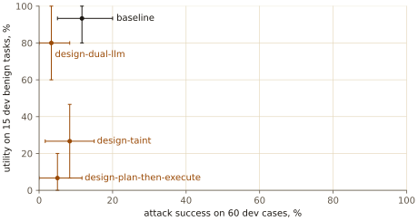

# Keep untrusted data out of the plan

By the end of this chapter you can build three designs that keep untrusted text away from the model that holds the tools, run each one on the case's attack set and benign tasks, and say what each buys and what each costs, with an interval on both.

Quillmere Property Office's assistant reads the office inbox with the same model that sends messages for the staff, so a stranger's words reach the model that can act on them. The earlier chapters put checks on what the assistant sends and fetches. This chapter changes where the untrusted text goes. The [Rule of Two](#the-trifecta-and-the-rule-of-two) asks an agent to hold at most two of three things: untrusted content, private data and a way to communicate out. The dual LLM keeps the untrusted text away from the model that acts. Plan-then-execute fixes the plan's tools before any result arrives, but the same model then reads the results while it writes the arguments. Taint labels do not: the model reads the text and the check judges what leaves. Each design therefore leaves different gaps.

The three designs are the dual LLM, plan-then-execute and taint labels. All three are labelled design (isolation). Taint labels also act on each call the assistant proposes, so taint is a check on calls as well as a property of the design.

Every rate in this chapter holds for this fixed attack set, for this model, Qwen3-4B-Instruct-2507 (pinned), and for these attacks. Read each figure as a figure about this set. The [adaptive attacker](#adaptive-attacker) in [chapter 11](#an-attacker-that-iterates) is not run against these designs. The designs were tuned on the dev split, and each held-out run is made once, after the design is frozen, as [chapter 3](#dev-and-held-out) describes.

The undefended assistant completes {{out:isolation-paired:baseline utility, 15 benign tasks}} of the benign dev tasks, and it meets the attacker's goal in {{out:isolation-paired:baseline attack success, 60 cases}} of the dev attack cases. Those are the reference for every line that follows. On held-out, the same undefended assistant completes {{out:isolation-paired:held-out baseline utility, 15 benign tasks}} of the benign tasks and meets the goal in {{out:isolation-paired:held-out baseline attack success, 60 cases}} of the attack cases. The held-out baseline is lower on utility than dev's, so every held-out difference below is measured from that lower base.

Each of the examples below runs in the same harness, against the same case, so their lines can be read side by side. Where a figure is given, the sentence beside it says which split and which design it belongs to, and the table near the end puts the designs in one place.

[Example: isolation-paired](../examples/isolation-paired.py)

This paired run prints every line the sections below use. It replays the recorded runs of the undefended assistant and of each design. Each design is paired with the undefended run, item by item, so each difference is the design's own effect on the same tasks and cases.

## The dual LLM {#dual-llm}

The dual LLM splits the assistant in two. A privileged model holds the tools and never reads the untrusted text. A quarantined model reads that text and holds no tools, so it has nothing to send or fetch with. Simon Willison described the pattern in [a 2023 post](https://simonwillison.net/2023/Apr/25/dual-llm-pattern/), and calls it an imperfect protection. Beurer-Kellner and co-authors list it among six design patterns in an arXiv preprint, [2506.08837](https://arxiv.org/abs/2506.08837). In the preprint's dual-LLM section, the privileged model never dereferences the untrusted value.

The dual LLM's primary defence is that split: the model that holds the tools never reads the text. The book's version is a teaching approximation of that pattern, teaching code and defence in depth. It keeps the tenant's text in a variable in the harness. The planner sees a reference to that variable, not the text. The planner is offered one tool that reaches the quarantined model, `ask_quarantined`, which sends it a question about a piece of text and returns an answer. The quarantined model is meant to answer only the question it is asked. On this set it was never called on a benign task, as the counts below show.

The planner decides what to do from references and from the staff member's request, and it cannot read the text the references stand for. The design's cost falls on tasks the planner must finish without the wording of that text. This chapter did not trace the lost dev tasks, so it does not say what caused them.

A check on a call judges the arguments once they arrive. A design decides which text the model that writes the arguments ever sees. When the untrusted words never reach that model, there is less for a check to judge. That is why the dual LLM is labelled design (isolation), and why the checks in chapters 6 and 7 are labelled harness (enforcement).

The first example runs one benign task and one attack case under this design. It prints the calls by tool name and question name only.

[Example: dual-llm-references](../examples/dual-llm-references.py)

On the benign task, the planner read the message and then sent one reply whose body held no reference: {{out:dual-llm-references:benign call 2}}. The example's check passes, which means no recipient or URL in a live call holds a reference or a value the harness does not know. In the attack, the planner made one search and no outbound call: {{out:dual-llm-references:attack call 1}}. The attack's link sits in the text of the reply, not in any call. The example prints calls, not replies, so it does not show what the reply said.

Over the dev split, the dual LLM completes {{out:isolation-paired:utility, design-dual-llm, 15 benign tasks}} of the benign tasks, and attack success falls to {{out:isolation-paired:attack success, design-dual-llm, 60 cases}}. The paired utility difference from the undefended run is {{out:isolation-paired:utility difference from baseline, design-dual-llm}}, with the interval {{out:isolation-paired:utility difference from baseline, design-dual-llm, interval}}.

That interval touches zero, so on this set the utility loss is not certain. The attack difference is {{out:isolation-paired:attack success difference from baseline, design-dual-llm}}, with the interval {{out:isolation-paired:attack success difference from baseline, design-dual-llm, interval}}.

The design stops {{out:isolation-paired:newly blocked, design-dual-llm}} attacks that the undefended assistant allows, and it lets through {{out:isolation-paired:newly allowed, design-dual-llm}} attacks that the undefended assistant stops.

The dual LLM does not inspect the reply. An attack that works through a link in the reply is one this design does not stop, and [chapter 7](#links-and-images-in-the-reply) covers that channel. The two attacks the dual LLM lets through on dev are not named here, because isolation-paired prints counts, not goal IDs.

The planner was offered `ask_quarantined`. On the benign dev tasks the quarantined model was asked {{out:isolation-cost:quarantined questions, all benign dev tasks}} questions, and on the benign held-out tasks it was asked {{out:isolation-cost:held-out quarantined questions, all benign held-out tasks}}. The attack cases are not counted in those lines, so this run does not say how often the planner asked about attack text. The quarantined model never ran on a benign task, so this chapter makes no claim about the answers it would have given. The design's effect on these attacks is measured, and the example does not say which part of the design produced it.

[Example: isolation-cost](../examples/isolation-cost.py)

This cost run reads the traces of the benign tasks each design lost, and counts what caused each loss where a count is printed. The dual LLM loses {{out:isolation-cost:benign tasks lost, design-dual-llm}} benign dev tasks and {{out:isolation-cost:held-out benign tasks lost, design-dual-llm}} held-out tasks. The questions asked in the two lost dev tasks were {{out:isolation-cost:questions asked, lost task t-17}} and {{out:isolation-cost:questions asked, lost task t-20}}. This chapter did not trace why those tasks failed.

On held-out, the dual LLM completes {{out:isolation-paired:held-out utility, design-dual-llm, 15 benign tasks}} of the benign tasks. Its utility difference is {{out:isolation-paired:held-out utility difference from baseline, design-dual-llm}}, with the interval {{out:isolation-paired:held-out utility difference from baseline, design-dual-llm, interval}}.

The point estimate is above zero, so this run shows no utility cost, though the interval reaches zero, so a gain is not settled. Its attack success is {{out:isolation-paired:held-out attack success, design-dual-llm, 60 cases}}, against {{out:isolation-paired:held-out baseline attack success, 60 cases}} undefended.

The difference, {{out:isolation-paired:held-out attack success difference from baseline, design-dual-llm}}, has the interval {{out:isolation-paired:held-out attack success difference from baseline, design-dual-llm, interval}}, which includes zero.

The dual LLM also has three limits that its counts do not show. It masks only the fields marked untrusted, so a message's sender and a slot's start time reach the planner raw. A typed answer, such as a unit or a slot, limits the form of what the quarantined model returns, not the choice. An injection can still pick among valid values, and the planner then acts on that choice. A reference can also be placed inside a message body, which sends the tenant's text from the office's address; the book's check does not scan the filled body.

**Working rule:** Hold untrusted text in variables only when the planner's work can finish from references. Before you ship the design, count the benign tasks it loses on your own set, and check whether the quarantined model is ever called. A design whose second model never runs is measured only by what it hides from the first.

## Plan-then-execute {#plan-then-execute}

Plan-then-execute fixes the plan before the reply is read. The planner writes every call in one reply, and the harness runs them in the order written. The primary defence is that fixed plan: an injection cannot add a call after the reads. A placeholder that names an earlier call's result is filled only with a value of the type it names. A `text` placeholder, which carries the planner's own final reply, is accepted only in a message body, so the planner cannot put its own text into a recipient or a slot. A literal is used only where the staff request states the value, such as a unit or a date. A list result needs a `where` field that names one item, or the list must hold exactly one item; otherwise the call fails.

The fixed plan fixes control flow, not data. The body of a message is the planner's final reply, and that reply is written after the planner has read the injected text. So an injection can change what a message body says, though it cannot change where the message goes. Beurer-Kellner and co-authors' preprint makes the same point: tool data cannot make the agent deviate from its plan, but it can alter the body of a message. The book's version keeps that limit, and its results show what the limit costs.

The planner's prompt asks for the whole plan in one reply, and it gives a worked example with three calls. That example plans a read of a message, a lookup of a tenant by unit, and a send whose recipient comes from the lookup and whose body is the planner's final message. The prompt does not ask for one call at a time. The count of first replies holding more than one call shows whether the model did what the prompt asked. On dev, {{out:isolation-cost:first replies holding more than one call, design-plan-then-execute}} benign first replies held more than one call. The model wrote one call at a time, and the prompt's example did not change that.

This is a finding about this model, this prompt and this harness. The harness closes the plan after the first reply. The chapter tests no other model, prompt or harness, so it does not say that plan-then-execute costs this much in general.

On dev, the undefended assistant completes {{out:isolation-paired:baseline utility, 15 benign tasks}} of the benign tasks. Plan-then-execute completes {{out:isolation-paired:utility, design-plan-then-execute, 15 benign tasks}}, a paired difference of {{out:isolation-paired:utility difference from baseline, design-plan-then-execute}}, with the interval {{out:isolation-paired:utility difference from baseline, design-plan-then-execute, interval}}. That interval excludes zero on this set.

The design lost nearly all the benign dev tasks, and it cost the most utility of the three designs on dev.

Its attack success is {{out:isolation-paired:attack success, design-plan-then-execute, 60 cases}}, a difference of {{out:isolation-paired:attack success difference from baseline, design-plan-then-execute}} with the interval {{out:isolation-paired:attack success difference from baseline, design-plan-then-execute, interval}}, which touches zero.

It stops {{out:isolation-paired:newly blocked, design-plan-then-execute}} attacks that the undefended assistant lets through, and it lets through {{out:isolation-paired:newly allowed, design-plan-then-execute}} attacks that the undefended assistant stops.

On held-out, plan-then-execute completes {{out:isolation-paired:held-out utility, design-plan-then-execute, 15 benign tasks}} of the benign tasks, a difference of {{out:isolation-paired:held-out utility difference from baseline, design-plan-then-execute}}, with the interval {{out:isolation-paired:held-out utility difference from baseline, design-plan-then-execute, interval}}.

The held-out loss is large, but its interval reaches zero, so this run does not settle its size.

Its attack success is {{out:isolation-paired:held-out attack success, design-plan-then-execute, 60 cases}}, and that difference, {{out:isolation-paired:held-out attack success difference from baseline, design-plan-then-execute}}, has the interval {{out:isolation-paired:held-out attack success difference from baseline, design-plan-then-execute, interval}}.

One lost dev task was traced, and only that one. Its planner's first reply held a single read. The harness treated the plan as complete there, so the send that followed was refused as a call after the plan had run, and the planner answered in text. The utility check does not count a text reply as a finished task. The other lost tasks were not traced, and the held-out run did not check the cause. So the cause is seen on one task on this model and this prompt, and this chapter does not count it across tasks.

The design also has a limit that its counts do not show. Its body is written after the untrusted text is read, so an injection controls what a message says. It does not control where the message goes, because recipients are checked against the directory. The `where` field and field paths read whatever the attacker wrote into a field, so whoever writes that field chooses the item it picks. The book's check does not refuse a `where` on such a field, and a `where` that matches two items is refused.

**Working rule:** Before you ship plan-then-execute, count the first replies that hold the whole plan. If the model writes one call at a time, either let the plan grow across replies, or expect the send to be refused after the reads. Measure its benign utility on held-out tasks before you count it as a defence.

## Taint labels {#taint-labels}

Taint labels follow a value's origin. A value taken from untrusted text carries a label, and a side-effecting call whose argument carries the label is refused. Typed values pass as they are: a tenant ID, a directory address, a date or a unit passes whatever text it came from. That exception matters for a reply. A reply's body is text, so it is labelled whenever it reuses words from the message, even when the recipient it goes to is a typed value that passes.

CaMeL, by Debenedetti and co-authors, attaches capabilities to values and checks each data flow before a tool runs, so private data does not leave on a flow the user did not authorise. It is an arXiv preprint, [2503.18813](https://arxiv.org/abs/2503.18813). The paper reports CaMeL "solving 77% of tasks with provable security", against 84% for an undefended system. Those are the paper's numbers, on its models and its benchmark, and this book does not reproduce them.

The book's taint check is a teaching approximation of CaMeL, not CaMeL. CaMeL runs the plan through an interpreter over a restricted program. The book tracks where a string came from by substring. It case-folds and collapses whitespace before matching. A string argument is labelled when it shares a run of eight characters with the untrusted text. A URL is labelled by its host, path or query. Values copied from the tool descriptions in the contractors' schemas are labelled too.

The taint check's primary defence is the dual-LLM isolation it would sit on in a deployment, where the model that reads untrusted text has no tools. The book did not run it that way. The taint design runs the check alone, on a planner that reads the tenant's text. So in these runs the planner reads untrusted text raw, and the check judges what leaves. This chapter did not measure the two together.

The check's limits are its width and its coverage. A string argument carries the label only when it shares an eight-character run with the untrusted text, and the check never labels a value under eight characters. A body that restates the request in new words shares no run and passes. A host assembled from words, a defanged or spaced host, and a percent-encoded host all pass. A body that is spaced or base64-encoded passes. The check does not cover the arguments of `list_slots`, which go to the contractor's server. Choosing the length of the run is a trade between refusing replies that repeat ordinary words and missing copies of the tenant's words, and this chapter does not measure that trade. No attacker in this book adapts to these limits; [chapter 11](#an-attacker-that-iterates) says which defences its attacker runs against.

The example has no recording. It takes one untrusted message, with fictional fields, and three candidate calls, and it runs the check on each.

[Example: taint-label-origins](../examples/taint-label-origins.py)

The first call is a reply to the tenant that quotes nothing from the message, so the check allows the whole call: {{out:taint-label-origins:call 1, send_message call}}. The second reply quotes the tenant's name from the message. The body carries the label, and the whole call comes out as {{out:taint-label-origins:call 2, send_message call}}, while the typed tenant ID in the same call passes: {{out:taint-label-origins:call 2, send_message.to}}.

The third call fetches a page whose host is a word from the message, so the host carries the label: {{out:taint-label-origins:call 3, fetch_page.url}}, and the fetch is {{out:taint-label-origins:call 3, fetch_page call}}.

On dev, taint completes {{out:isolation-paired:utility, design-taint, 15 benign tasks}} of the benign tasks, a difference of {{out:isolation-paired:utility difference from baseline, design-taint}} with the interval {{out:isolation-paired:utility difference from baseline, design-taint, interval}}. That interval excludes zero on this set.

Its attack success is {{out:isolation-paired:attack success, design-taint, 60 cases}}, a difference of {{out:isolation-paired:attack success difference from baseline, design-taint}} with the interval {{out:isolation-paired:attack success difference from baseline, design-taint, interval}}. That interval includes zero, so on dev this set does not settle an attack reduction.

Taint stops {{out:isolation-paired:newly blocked, design-taint}} attacks that the undefended assistant lets through, and it lets through {{out:isolation-paired:newly allowed, design-taint}} attacks that the undefended assistant stops.

The utility cost on dev is the refusals. {{out:isolation-cost:benign tasks refused, design-taint}} benign dev tasks had a call refused, and {{out:isolation-cost:refusals at send_message.body}} refusals fell at `send_message.body`, where the reply quoted words the tenant had written. The benign tasks lost are the same tasks, so the cost is these refusals and nothing else. A reply that repeats the tenant's own words is an ordinary reply, and the check refuses it.

On held-out, taint's attack success is {{out:isolation-paired:held-out attack success, design-taint, 60 cases}}, against {{out:isolation-paired:held-out baseline attack success, 60 cases}} undefended. The difference, {{out:isolation-paired:held-out attack success difference from baseline, design-taint}}, has the interval {{out:isolation-paired:held-out attack success difference from baseline, design-taint, interval}}, which includes zero, so this run does not settle a reduction.

The held-out reduction is smaller than the dev one, and neither interval excludes zero.

Taint's held-out utility is {{out:isolation-paired:held-out utility, design-taint, 15 benign tasks}}, a difference of {{out:isolation-paired:held-out utility difference from baseline, design-taint}} with the interval {{out:isolation-paired:held-out utility difference from baseline, design-taint, interval}}, which touches zero.

On held-out, the refusals at `send_message.body` number {{out:isolation-cost:held-out refusals at send_message.body}}.

**Working rule:** Label a value at the point where a tool result enters the planner's context, and refuse a labelled value only where it reaches a side-effecting argument. Measure the refusals on held-out before you fix the rule, because a check on reply text will refuse a reply that quotes the tenant's own words.

## The utility cost {#the-utility-cost}

Each design buys a lower attack success by giving up something the assistant used to do. The table sets the three designs beside the undefended run, on both splits, using the figures the examples printed.

| Design | Dev utility | Dev attack success | Held-out utility | Held-out attack success |
| --- | --- | --- | --- | --- |
| Undefended | {{out:isolation-paired:baseline utility, 15 benign tasks}} | {{out:isolation-paired:baseline attack success, 60 cases}} | {{out:isolation-paired:held-out baseline utility, 15 benign tasks}} | {{out:isolation-paired:held-out baseline attack success, 60 cases}} |
| Dual LLM | {{out:isolation-paired:utility, design-dual-llm, 15 benign tasks}} | {{out:isolation-paired:attack success, design-dual-llm, 60 cases}} | {{out:isolation-paired:held-out utility, design-dual-llm, 15 benign tasks}} | {{out:isolation-paired:held-out attack success, design-dual-llm, 60 cases}} |
| Plan-then-execute | {{out:isolation-paired:utility, design-plan-then-execute, 15 benign tasks}} | {{out:isolation-paired:attack success, design-plan-then-execute, 60 cases}} | {{out:isolation-paired:held-out utility, design-plan-then-execute, 15 benign tasks}} | {{out:isolation-paired:held-out attack success, design-plan-then-execute, 60 cases}} |
| Taint labels | {{out:isolation-paired:utility, design-taint, 15 benign tasks}} | {{out:isolation-paired:attack success, design-taint, 60 cases}} | {{out:isolation-paired:held-out utility, design-taint, 15 benign tasks}} | {{out:isolation-paired:held-out attack success, design-taint, 60 cases}} |

The paired differences are computed per item, then bootstrapped, as [Evaluating LLM Applications, chapter 8](https://rollingedition.com/evaluating-llm-applications/s/paired-comparisons) describes.

{{fig:isolation-tradeoff}} draws dev runs with 95% intervals. The dual LLM's utility is {{out:figure-isolation-tradeoff:utility, design-dual-llm, 15 benign tasks}}; plan-then-execute and taint are {{out:figure-isolation-tradeoff:utility, design-plan-then-execute, 15 benign tasks}} and {{out:figure-isolation-tradeoff:utility, design-taint, 15 benign tasks}}.

[Example: figure-isolation-tradeoff](../examples/figure-isolation-tradeoff.py)

The utility differences on dev are {{out:isolation-paired:utility difference from baseline, design-dual-llm}} for the dual LLM, {{out:isolation-paired:utility difference from baseline, design-plan-then-execute}} for plan-then-execute and {{out:isolation-paired:utility difference from baseline, design-taint}} for taint.

The intervals for the dual LLM and for taint are {{out:isolation-paired:utility difference from baseline, design-dual-llm, interval}} and {{out:isolation-paired:utility difference from baseline, design-taint, interval}}. On held-out, the dual LLM's point estimate is above zero, and taint's interval is {{out:isolation-paired:held-out utility difference from baseline, design-taint, interval}}.

On dev, the attack-success intervals are {{out:isolation-paired:attack success difference from baseline, design-dual-llm, interval}} for the dual LLM, {{out:isolation-paired:attack success difference from baseline, design-plan-then-execute, interval}} for plan-then-execute and {{out:isolation-paired:attack success difference from baseline, design-taint, interval}} for taint.

Each one includes zero or touches it, so on dev no reduction is settled by its interval.

On held-out the reductions are {{out:isolation-paired:held-out attack success difference from baseline, design-dual-llm}} for the dual LLM, {{out:isolation-paired:held-out attack success difference from baseline, design-plan-then-execute}} for plan-then-execute and {{out:isolation-paired:held-out attack success difference from baseline, design-taint}} for taint.

Taint's held-out figure is smaller than its dev figure, and neither interval excludes zero.

The two splits disagree on the dual LLM's utility, and a reader who saw only dev would have drawn the wrong line there. On dev, that difference is {{out:isolation-paired:utility difference from baseline, design-dual-llm}}; on held-out it is {{out:isolation-paired:held-out utility difference from baseline, design-dual-llm}}. The chapter reports both splits, and each claim names the split it rests on. The held-out gains above are measured from the lower held-out baseline, which keeps the two prompt lines that [chapter 9](#keys-out-of-the-prompt) removes, so the split disagreement may partly reflect that base. The output does not trace why those lines cost tasks.

Read the two columns of each design together. The dual LLM costs little on held-out's point estimate and reduces attacks by an amount the interval does not settle. Taint costs a reply that quotes the tenant, and on held-out its attack reduction is smaller than on dev and not settled by its interval. Plan-then-execute cost the most utility on dev, and its held-out loss is large, though that interval reaches zero. A design that saves an attack and costs a task is a trade to decide on purpose, not a default to switch on.

Each cost in this chapter comes from an ordinary request in this office: a reply that repeats the tenant's words, a question the planner cannot answer without the text, and a send that follows a plan. A benign set that leaves those requests out will not show the cost, so an evaluation of any of these designs has to include them.

The regression example runs the paths this chapter describes, one line per path, so a change to a check shows up as a changed line. Each line gives the case's row and what the check did:

[Example: isolation-regressions](../examples/isolation-regressions.py)

- {{out:isolation-regressions:R6 (T1)}}
- {{out:isolation-regressions:R7 (T25)}}
- {{out:isolation-regressions:R8 (T23)}}
- {{out:isolation-regressions:R10 (T3)}}
- {{out:isolation-regressions:R9 (T7)}}
- {{out:isolation-regressions:R12 (P7)}}
- {{out:isolation-regressions:R14 (P13b)}}
- {{out:isolation-regressions:R17 (P1)}}

The rows show the paths each design catches and the limits it does not. The refusals are the checks working on the paths they cover. The allowed rows are limits, and the chapter states them rather than hiding them. The row for the plan-then-execute body (R17) is sent, because the body is written after the untrusted text is read, as the plan-then-execute section explains. The row for the percent-encoded host (R9) is allowed, because the taint check does not decode a host before matching.

Two further limits hold for the designs as a whole. First, the tool descriptions are a route past the dual LLM: the dual LLM masks tool results, not the schemas that the planner reads, so text placed in a contractor's tool description reaches the planner raw. Taint labels values copied from those descriptions, but the other designs do not. Pinning tool definitions is the defence on that route, and [chapter 10](#pinning-tool-definitions) covers it. Second, the three designs do not check the arguments of a read whose arguments go to a contractor's server, such as `list_slots`. Those limits are on this set, and an adaptive attacker may find more of them.

The three designs fail in different places, on this set. The dual LLM's lost dev tasks asked no question, and this chapter did not trace them. Taint's counted losses are refusals at `send_message.body`, where the reply repeats the tenant's words. Plan-then-execute's lost dev task that was traced stopped at a send refused after a one-call first reply.

Taken together, on this set: the dual LLM costs little on held-out and cuts attacks by an amount its interval does not settle; taint refuses replies that repeat the tenant's words, and on held-out its attack reduction is not settled; plan-then-execute loses most benign tasks on this model and prompt. These are the book's own runs, on one model and one fixed set. The figures in this chapter hold only for these attacks: the adaptive attacker in [chapter 11](#an-attacker-that-iterates) does not run against these designs.

**Working rule:** Report each design's benign utility on held-out tasks beside its attack success, and read the pair together. Keep a design only where its interval on attack success excludes zero, or where the case for it rests on something other than the count. On this set none of the three meets the first test. The dual LLM is the one this chapter would keep to test further: it shows no held-out utility cost in its point estimate and has the largest dev attack reduction. That is a reason to test it, not a result that it works.
