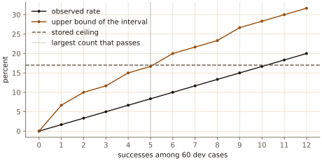

# Keep the defences from regressing

By the end of this chapter you can run the defended assistant's attack set as a gate that fails a change which weakens a defence. You'll choose the gate's thresholds from the dev split and store them, log the security events that answering an incident needs, and answer an incident from that log. You'll also know what the numbers can and can't support.

The office's assistant has been attacked and defended in the chapters before this one, and each defence was measured once. That measurement is true of the code, the wording and the recording as they were on the day it ran. Nothing in the book so far says when a later edit has made a defence weaker. A reworded warning, a host added to an allowlist or a changed tool description can reopen a route that the earlier number no longer covers, and nobody notices until an attack succeeds. This chapter turns the measurement into a gate that runs with each change. It builds no new defence. It holds a defence to the number it was measured at, and its example does that for the argument policy from chapter 6.

## Run the defended set through a gate {#the-gate}

A gate is a check that stops a change when a number gets worse. This one runs a defended configuration on the dev split, replayed from its stored recording, and compares the result with two stored thresholds. The first is a ceiling on attack success. The second is a floor on utility, measured against the undefended run. The configuration the example protects is the argument policy from [chapter 6](#argument-policies), which the standards table calls `enforce-args`.
Both checks compare an interval bound with a threshold, and neither compares a point rate. The attack check uses the upper bound of a bootstrap interval over the dev attack cases. The utility check uses the lower bound of the paired difference from the undefended run, computed task by task. Each interval is set at 97.5%, the level that [Evaluating LLM Applications, chapter 8](https://rollingedition.com/evaluating-llm-applications/s/many-comparisons) gives for two comparisons: 1 minus 0.05 divided by 2. The bootstrap and the paired difference are that book's, as its [chapter 8](https://rollingedition.com/evaluating-llm-applications/s/bootstrap-over-items) and [paired comparisons](https://rollingedition.com/evaluating-llm-applications/s/paired-comparisons) define them.

The direction of the gate is this book's own choice, and it runs the other way from Evaluating LLM Applications. That book's [gate section](https://rollingedition.com/evaluating-llm-applications/s/a-gate-that-respects-the-interval) fails only when the data proves a drop: the upper bound of the difference must lie below minus the threshold. This gate passes only when the pessimistic bound clears its threshold. The attack check asks whether even the upper bound of attack success is at or under the ceiling, and the utility check asks whether even the lower bound of the utility difference is at or above the floor. A security gate asks for evidence that a defence holds, not only for proof that it has dropped, so a change has to show it stayed inside the bound. The cost is that the gate can fail on noise: on a set this size, one lost benign task is enough to fail the floor.
The gate runs on the dev split only. The held-out split is run once per defence, after the defence is frozen, by hand, and its number is the only one the book claims for that defence, as [chapter 3](#dev-and-held-out) explains. A gate that reran held-out on every change would spend the split on the first change, and every later held-out number would be one the team had already seen. The [held-out-once rule](https://rollingedition.com/evaluating-llm-applications/s/held-out-once) in Evaluating LLM Applications gives the reason in full.

The utility floor is measured against the undefended run, so the baseline's recording is part of the gate as well. The baseline keeps the two prompt lines that [chapter 9](#keys-out-of-the-prompt) removes, and the floor is set against it as it stands. A change to the baseline's replies moves the floor, so that change needs the same review as a change to the defence.

The next example runs the gate on two runs: one with the defence switched off, and one with a single case changed. It prints both checks for each run, and then a sweep that shows how many successes the attack check tolerates.

[Example: gate-catches-a-regression](../examples/gate-catches-a-regression.py)

Catching a regression needs one to catch, and the book has no recording of a partial one. There is no recording of the allowlist without its fetch rule, for instance. So the regressed run is the undefended baseline's replies, which is what the assistant does with the defence switched off. That is the largest regression the gate can see. The example shows that the gate notices a defence's loss, and it says nothing about how small a loss the gate would notice.

The regressed run fails the attack check. Its upper bound is over the stored ceiling of {{out:gate-catches-a-regression:ceiling, stored}}, and the example prints `failed checks, regressed run: {{out:gate-catches-a-regression:failed checks, regressed run}}`, which is the attack check alone. The utility check passes trivially: the regressed run is the baseline, so its paired difference with the baseline is zero. Only the attack check can see this regression. The check fails on the bound, not on the rate, and [the next section](#thresholds-and-intervals) explains why that is the number to read.

Next, one case is changed. The code takes the first case the defence held, in ID order, which is {{out:gate-catches-a-regression:flipped case}}, and makes it a success in its own copy of the defended run. The upper bound moves from {{out:gate-catches-a-regression:attack success upper bound, defended}} to {{out:gate-catches-a-regression:attack success upper bound, one case flipped}}, which is still under the ceiling, so that run passes both checks. The ceiling is set to allow exactly this one-case move, so the pass is built in. What the flip shows is that noise on a single case doesn't fail the gate. It doesn't show that the defence would hold if ten cases changed.

The sweep answers that question for the attack check. It gives each count from 0 to 60 successes to the same check and prints the largest count that passes, which is {{out:gate-catches-a-regression:largest count of successes that passes the attack check, of 60 cases}} of 60. The first count that fails is {{out:gate-catches-a-regression:smallest count of successes that fails the attack check}}. A defence with a few cases of room below that count can be crossed by a small change.

{{fig:gate-boundary}} draws the first 13 counts of that sweep, from 0 to 12 successes among the 60 dev cases. The lower line is the observed rate. The upper line is the upper bound of its interval, the number the check reads, and the dashed line is the stored ceiling of {{out:figure-gate-boundary:ceiling, stored}}. The rate alone first reaches that ceiling at {{out:figure-gate-boundary:count at which the rate alone reaches the ceiling}} successes, well above the pass line.

[Example: figure-gate-boundary](../examples/figure-gate-boundary.py)

The largest count that passes is {{out:figure-gate-boundary:largest count that passes, of 60 cases}}, where the upper bound is {{out:figure-gate-boundary:upper bound at the largest passing count}}, and the smallest that fails is {{out:figure-gate-boundary:smallest count that fails, of 60 cases}}, where it is {{out:figure-gate-boundary:upper bound at the smallest failing count}}.

Read which check fails. A failed attack check means the defence got weaker on dev. A failed utility check means it costs benign tasks. Those are different problems with different fixes.

**Working rule:** Run the gate on every change to a defence's code, wording, policy or recording, on the dev split only. Treat a failed check as a regression until someone has found its cause on dev. Don't rerun held-out to see whether a failing change passes, because that spends the split.

## Choose thresholds once, from dev {#thresholds-and-intervals}

A rate computed from {{out:gate-thresholds:attack cases compared}} dev attack cases carries the noise of those cases. Add or remove one success and the rate moves, which looks small until a team reads the movement as a change in the defence. An interval says how far the rate could move on the same cases under resampling. The threshold is read against the upper bound of that interval, which asks a harder question than the rate does: is even the pessimistic reading of this run at or under the ceiling? The bootstrap resamples the cases with replacement, with a fixed seed, so the same replies always give the same bounds.

The thresholds come from one place. The recording script `recordings/gate_thresholds.py` chooses them from dev and writes them to `examples/data/gate/thresholds.json`. It writes a new value only when the dev choice changes, and it prints the old and new values. The code reads that file, runs the same rule over the dev runs again, and asserts that the stored values match the new choice. It also runs both checks on the defended run with the stored values, and the defended run passes both.

The next example prints the dev numbers the rule reads, and the two checks it gives the defended run.

[Example: gate-thresholds](../examples/gate-thresholds.py)

The rule has two parts, and each one is a sentence about a bound.

The ceiling is the defended run's upper bound, with one more of its held cases counted as a success, rounded up to a whole point. On dev the defended run reads {{out:gate-thresholds:dev attack success, defended}}. With one more case counted as a success, its upper bound is {{out:gate-thresholds:dev attack success, upper bound with one more case}}, so the stored ceiling is {{out:gate-catches-a-regression:ceiling, stored}}. The extra case is the noise allowance. Without it, a gate would fail on one case of noise alone.

The floor is the lower bound of the paired utility difference, defended minus baseline, rounded down to a step of five points. On dev that lower bound is {{out:gate-thresholds:dev utility difference, lower bound}}, so the stored floor is {{out:gate-catches-a-regression:floor, stored}}.

The floor is strict, and the book chose it on purpose. The benign set has {{out:gate-thresholds:benign tasks compared}} tasks on dev. A run that loses one benign task has a paired difference of one task lost, and the bootstrap's lower bound then falls under zero, so the gate fails it. A floor of zero therefore means that any lost benign task fails the gate on dev, and a defence that costs utility will fail here. A team that accepts some lost utility for a larger gain in safety may loosen the floor. The place to do that is the rule in the gate's code, applied on dev, with the new value stored and the reason written next to it. It is never done by looking at held-out first.

The stored file is compared with the new choice, and the result reads: {{out:gate-thresholds:stored thresholds}}. If they ever differ, a threshold has been edited by hand, and the example fails until someone chooses again on dev.

The gate checks dev, which is the split its thresholds were chosen from. So it can catch a defence that drifts on the cases it was measured on. It cannot show that the defence holds on cases it has not seen. That claim belongs to the held-out run, made once per defence. [Chapter 11](#the-gap-to-the-fixed-set)'s attacker ran on dev cases only and does not test unseen cases.

**Working rule:** Choose each threshold once, on dev, from the defended run and the baseline, and store it with the rule that produced it. Read each check against the interval's bound, never against the rate. A change to a threshold is a new choice on dev, reviewed like any other change to the gate.

## Log what the defences decide {#security-events}

The gate tells a team that a defence got weaker. It doesn't tell them what happened when the defence acted, and an incident is usually about that. So the security log records every outbound call the assistant makes, `send_message` and `fetch_page`, allowed or refused, with its host, and every result a defence withholds, with the reason. An accepted fetch appears as an allowed line, because an accepted fetch to an outside host is the incident itself. Each line holds the item, the defence, the tool, the host, the decision and the reason. Each refusal of any other call is logged too, with no host.

The security log holds only what detecting and answering an incident needs. It is not a trace of the whole run. The model's replies, token counts and timings are tracing, and tracing belongs to [Agent Harnesses, chapter 11](https://rollingedition.com/agent-harnesses/s/one-line-per-event), which teaches the trace format, and to the planned Observability book. A reader who builds this log in production should keep its own field names and map them to a standard's in one table, at the edge, as Agent Harnesses explains in [its section on field names](https://rollingedition.com/agent-harnesses/s/own-fields).

The next example builds the log from the replayed dev runs of the undefended run and of each defence the log covers. It prints the first lines and the counts, then runs two queries on the log alone.

[Example: security-events-log](../examples/security-events-log.py)

Each line comes from one configuration's own dev run. A deployed log would hold only the configuration that ran, and no run in this book had two defences active.

The log in this book has no times, and that is a deliberate choice for the book. The same replies always produce the same lines, in the same order, so the output is exact and a reader can check it. A real log carries times, and an incident responder needs them to put events in order. A reader who adds clocks should add them where the log is written, and the events the log holds stay the same. The code writes nothing into the book. It prints what it finds.

The printed counts show what the log holds on dev. The log has {{out:security-events-log:log lines}} lines. The detector withheld text {{out:security-events-log:events, detector-filter, withhold}} times, and the egress rule refused {{out:security-events-log:events, egress-fetch, refuse}} fetches. The argument policy and the approval gate also refuse calls that are not outbound, such as a booking or a tenant lookup, and the log keeps those refusals too, with no host: a refused lookup is often the first sign that an injection tried to pull another tenant's record. The rough allowlist is absent too, since it has no dev recording to replay. The prompt defences log nothing, since they take no decision on a call or a result. They change the words the model reads, and the log has no line for a change to words.

**Working rule:** Log every outbound call, allowed or refused, every refusal of another call, and every withheld result, with its host where the call has one, and log nothing else until an incident needs it.

## Answer an incident from the log {#answering-an-incident}

Suppose a reader's review finds that a fetch reached a host the office doesn't use. The steps below work the same way for any defence whose log lines the reader has. They don't assume the event was an attack, and they don't assume it was caught. They are a way to find out what the log says, and they read the log alone.

The first step is the log's first query. Take the case ID from the report and read every refusal logged for it. The query runs for the first case the egress rule refused, which is {{out:security-events-log:query 1, case}}. The log holds {{out:security-events-log:query 1, refusals for the case}} refusals for that case, from two defences: the egress rule refused its fetch, and in its own dev run the argument policy refused both the fetch and the tenant lookup that came before it. The reader learns that two defences refused the same fetch, and that one of them had already refused the lookup that tried to fetch the tenant's record first. Each line stays with the defence that wrote it, so the reader can see what each one decided.

The second step asks whether the same kind of event happened elsewhere, under the other configurations. The second query lists every fetch the log allowed to a host outside the office's own, under the undefended run and under the egress rule. The undefended run's log holds {{out:security-events-log:query 2, fetches to an outside host, baseline}} such fetches, and the query prints each case and the host it reached. Under the egress rule the count is {{out:security-events-log:query 2, fetches to an outside host, egress-fetch}}. Both counts are on the dev split, with this model, and the example asserts that the egress rule's log holds no allowed fetch to an outside host, so a change that let a fetch out would fail the example.

Comparing the two lines for one case shows what each configuration decided on it. The log does not name a cause beyond that, so the reader's next question is about the change between the configurations, and the answer comes from the defence's code and replies.

The log does not say what happened. It is replayable, because each line is fixed by its replies, and that is what makes it useful. It doesn't say why a case reached the model at all, which user's data was in its context, or whether the reader's report describes the same event the log records. Those are the reader's questions, and the reader answers them with the evidence from the replies, not from the log's lines alone.

An answer from the log covers only the cases in the set. A route the set doesn't hold can't be found by any query in this section. [Chapter 11](#an-attacker-that-iterates) varies the set's own cases and adds no locations or channels, so it does not test that gap. A clean log is only as good as the set it was built from.

**Working rule:** When an incident names a case, read every refusal logged for it before you read any code. Then read that case's lines under each configuration, and don't name a product as the cause. Don't reproduce a real incident's payload to test an answer.

## Report in the standards' terms {#reporting-in-the-standards-terms}

A team that reports to an auditor or a security lead needs the defences in the terms those readers use. Which risk does each defence address? Where does it act? The standards-report example prints one line per defence the book measures, with its label and the risk IDs it is aimed at, so that the table can't drift from the measurements.

The next example prints that table, and it asserts that the table covers exactly the defences that have a recording the example can replay.

[Example: standards-report](../examples/standards-report.py)

The four labels are the book's, and they say where a defence acts. A prompt defence changes the words the model reads. An input defence looks at text before the model reads it, and the book's one input defence is a detector, which [chapter 5](#picking-a-threshold-on-dev) measures. A harness defence checks the model's calls or replies outside the model, and the book's enforcement rules are of that kind. The design label, for a defence that is a property of how the system is built, covers the three isolation designs of [chapter 8](#dual-llm) and the removal of secrets from the prompt in [chapter 9](#keys-out-of-the-prompt).

The risk IDs come from the OWASP lists, and each one is printed with its list's year or date. `LLM01:2026` Prompt Injection is the risk for the prompt defences and for the input detector. `LLM02:2026` Sensitive Information Disclosure and `LLM03:2026` Excessive Agency are the risks for the egress rule and the rough allowlist. `LLM03:2026` and `ASI02` Tool Misuse & Exploitation are the risks for the argument policy, the approval gate and the tool filter (`enforce-filter`, [chapter 6](#a-tool-filter-per-task)). The LLM names are from the OWASP LLM Top 10 2026, whose release is recorded at its [Zenodo DOI](https://doi.org/10.5281/zenodo.22109014). The agentic names are from the OWASP Top 10 for Agentic Applications, [published on December 9, 2025](https://genai.owasp.org/resource/owasp-top-10-for-agentic-applications/).

The report prints {{out:standards-report:defences measured}} defences, and it prints no MITRE ATLAS release number. The book has not yet read which ATLAS release is in force, and a number it couldn't check would be worse than none.

Two cautions go with the table. A mapping says which risk a defence is aimed at. It doesn't say the risk is covered, and the table can't tell a reader how much of the risk remains. The second caution is that a row describes the defence on this set, with this model, and the measurements from earlier chapters are the only evidence for it.

The table is not complete. It leaves out three measured controls: the render policy and the secret scan of [chapter 7](#links-and-images-in-the-reply), and `cite_provenance` of [chapter 9](#poisoned-documents-in-the-index). It has no row for `LLM10:2026`, which chapters 2 and 7 map to the reply.

**Working rule:** Print each risk ID with its list's year or date, take them only from the lists the book has checked, and state each mapping as the risk a defence is aimed at. Print the label from the same source as the measurements, so the report and the numbers come from one place.

## What the reader has now {#what-the-reader-has}

The gate shows that a defence did not get worse on the fixed set, with this model and these attacks. It doesn't show that the defence stops the attacks the set leaves out, and no check in this chapter can find those. What the reader has at the end of the book is a set of attacks that is fixed, split and scored in code, a gate that holds a defence to its measured bound on dev, a log that says which outbound call and which withheld result came from which defence, and a report in the terms a standard uses. Each of these is only as wide as the set it was measured on. No chapter in this book tests a defence against attacks outside the set. [Chapter 11](#an-attacker-that-iterates)'s adaptive run, on twelve dev cases and five defences, added no successes. That is weak evidence, as that chapter says, and it is no reason to read a gate's pass as covering an attack the set does not hold.

The gate reads two numbers, so a reply that neither check scores is outside it. The log has no clocks, so it cannot order events in time.

The book also leaves some things unmeasured, and a reader should know which before taking a pass as settled:

- The gate protects one defence, [enforce-args](#argument-policies), and runs on dev only.
- No adaptive run reached the held-out split ([chapter 11](#what-the-result-does-not-show)).
- The reply channel and the isolation designs of [chapter 8](#dual-llm) were not attacked adaptively. Nor were the controls of [chapter 9](#hidden-context) and [chapter 10](#pinning-tool-definitions).
- The office-host query rule in [chapter 7](#egress-rules) has not been tested against the case it was built for.
- Pinning has no attack rate ([chapter 10](#pinning-tool-definitions)).
- Memory across episodes is not measured ([chapter 9](#poisoned-documents-in-the-index)).

**Working rule:** Keep the gate on every change, and when a number is quoted, quote the set it came from.
